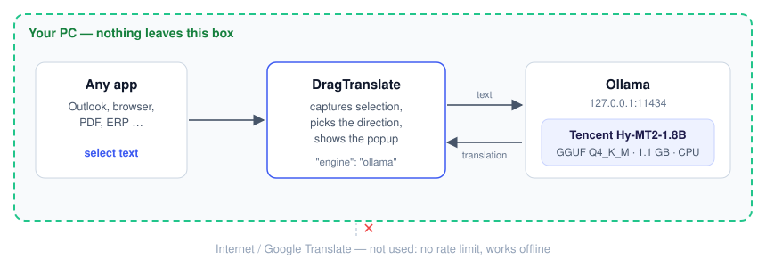

# DragTranslate v1.3.0

**Translate entirely on your own PC.** A new local engine runs Tencent's open-source
translation model **Hy-MT2-1.8B** in [Ollama](https://ollama.com): no Google, no rate
limit, works offline, and the text you select never leaves the machine.

Upgrading: quit from the tray icon, extract over your folder, run `install.bat` again. Your
settings and vocabulary are kept. Google remains the default engine; the local engine is
opt-in.

## Why

On a company network every device goes out through the same public address, and the free
Google endpoint rate-limits per address. The result was popups like *"Google is
rate-limiting the address this network goes out from"* that had nothing to do with your own
usage, and no setting could fix it. Running the model locally removes the network from the
picture altogether.

## Setting it up

1. `winget install Ollama.Ollama`
2. `ollama pull hf.co/tencent/Hy-MT2-1.8B-GGUF:Q4_K_M` (1.1 GB, once)
3. In `config.json`: `"engine": "ollama"`, then restart DragTranslate
4. `py dragtranslate.py --check` confirms Ollama is up, the model is there, and times a
   real translation

## The model

- **Hy-MT2-1.8B** by Tencent Hunyuan, quantized **Q4_K_M** GGUF:
  [`tencent/Hy-MT2-1.8B-GGUF`](https://huggingface.co/tencent/Hy-MT2-1.8B-GGUF),
  quantized from [`tencent/Hy-MT2-1.8B`](https://huggingface.co/tencent/Hy-MT2-1.8B)
- Licence: Apache-2.0 (per the model card). Not bundled - Ollama downloads it from Hugging Face.
- Paper: Zheng et al., *Hy-MT2: A Family of Fast, Efficient and Powerful Multilingual
  Translation Models in the Wild*, [arXiv:2605.22064](https://arxiv.org/abs/2605.22064) (2026)
- Prompt and sampling settings (temperature 0.7, top_p 0.6, top_k 20, repetition penalty
  1.05) are the ones recommended on the model card.

## Measured

AMD Ryzen AI 7 PRO 350 laptop, CPU only:

| | |
| --- | --- |
| One sentence, model loaded | 0.2 – 0.9 s |
| First translation after the model was unloaded | about 9 s |
| Memory while loaded | about 1.5 GB (Ollama) + about 150 MB (DragTranslate) |

The model is unloaded after `ollama_keep_alive` (default `10m`) without use.

## Details

- **No fallback to Google with the local engine.** If Ollama is not running or the model is
  missing, the popup says which, and how to fix it. Nothing is sent anywhere.
- **Ollama's chat template for this model is broken** - it leaves the user's text out, and
  the model answers with noise. DragTranslate builds the prompt in the model's own format
  (from the chat template stored in the GGUF) and sends it raw. Other models set in
  `ollama_model` use the normal chat API.
- The local engine skips the Google request spacing and back-off entirely, and connects to
  `127.0.0.1` directly, ignoring any `HTTPS_PROXY` or Windows proxy setting.
- New `config.json` keys: `ollama_url`, `ollama_model`, `ollama_keep_alive`,
  `ollama_timeout_sec`.
